<p align="center">
  
</p>

<p align="center">
  <b>A live map inside Facebook for plans you can join right now.</b><br>
  Muse turns "I'm free" into a real plan, with a friend you have and a chance to meet people you don't know yet.
</p>

<p align="center">
  <a href="https://youtu.be/5RyUiRBquXs"><b>▶ Watch the demo</b></a> ·
  <a href="https://out-here-three.vercel.app">Live demo</a> ·
  <a href="#run-it-locally">Run it locally</a> ·
  <a href="#how-we-use-muse">How we use Muse</a>
</p>

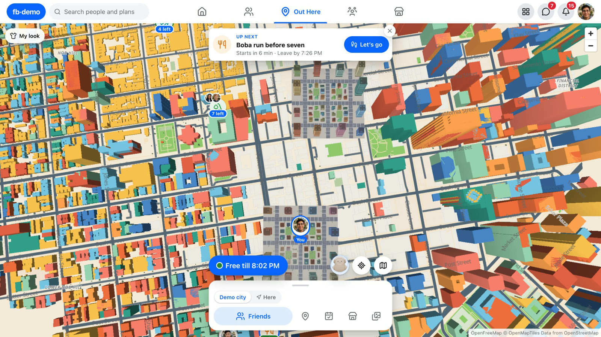

Built for the **Facebook Closer Together AI Hackathon 2026**. Every person in the app is fictional.

## The problem

You moved to a new city, you're three weeks into a new job, and you have 45 free minutes. You'd happily spend them with someone, but by the time a group chat answers, the time is gone.

The tools we already use don't help with that moment. Find My shows **where** your friends are, but not who's free or what they'd be up for. Event apps are built for things scheduled days ahead.

## The goal

Turn "I'm free" into a real plan in minutes. Start with someone you know, leave room for people you don't know yet, and give the group a reason to do it again.

## What it does

Out Here is one tab in a working Facebook-style web app. Its loop is: **I'm free → Muse finds the plan → go together → photo → do it again.**

- **Find My for friends.** Friends who share with you appear on a live map. Each one has a status bubble that says what they're doing and what they'd be up for ("craving dumplings", "free after class, down for boba"). You choose who sees you, whether your location is exact or approximate, and when to pause. Shared locations expire on their own.
- **I'm free.** Tell Muse what you want in plain words: *"I've got 45 minutes. Can I grab boba with someone nearby?"* Muse checks which friends are free, which places are open, and what fits your time window including the walk there. Then it suggests a plan, or drafts a new one with a friend when nothing posted fits.
- **Invite and go.** The invite arrives like any Facebook invite. When your friend accepts, seat counts update live on every screen.
- **Something pops up nearby.** When a seller opens a Marketplace pop-up, it appears on every map nearby. Muse matches each item to what each person cares about, such as a watch Alex set for a track jacket or a denim Reel Maya watched, and says why. You can reserve an item for pickup, and the seller accepts in real time.
- **Walk there together.** The map turns into a 3D city. You see your friend walking too, and plans float over the street with open seats and walking minutes counting down.
- **Take one photo together.** When everyone arrives, Muse looks at the photo, writes a caption, and saves it to an album shared by the people who were there.
- **Do it again.** The group becomes a crew. One tap on **Get this group together again** and Muse proposes the next plan that fits everyone.

Around the tab is a Facebook-style app with Feed, Friends, Groups, Marketplace, Events, Messenger and Notifications. It's seeded with about 60 fictional young adults in downtown San Francisco, so invites, notifications and Group hangouts arrive the way Facebook delivers things.

## Screenshots

<table>
  <tr>
    <td align="center" width="20%">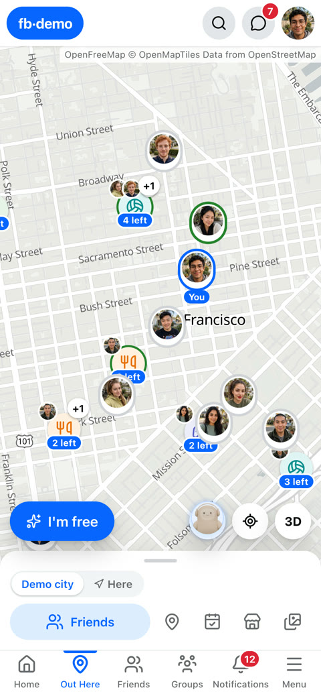<br><sub>Friends on the map</sub></td>
    <td align="center" width="20%">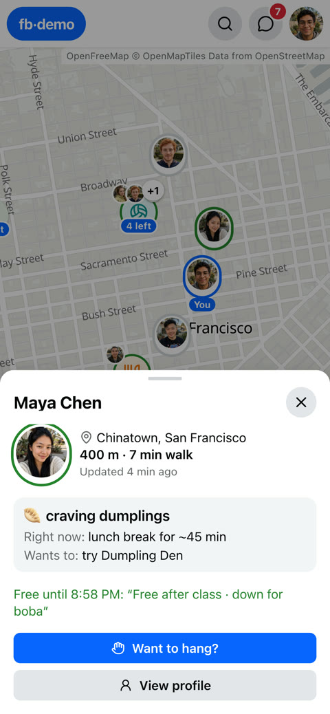<br><sub>A friend's bubble</sub></td>
    <td align="center" width="20%">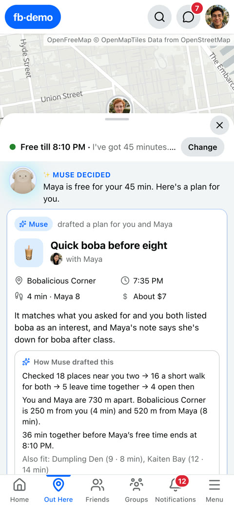<br><sub>Muse drafts a plan</sub></td>
    <td align="center" width="20%">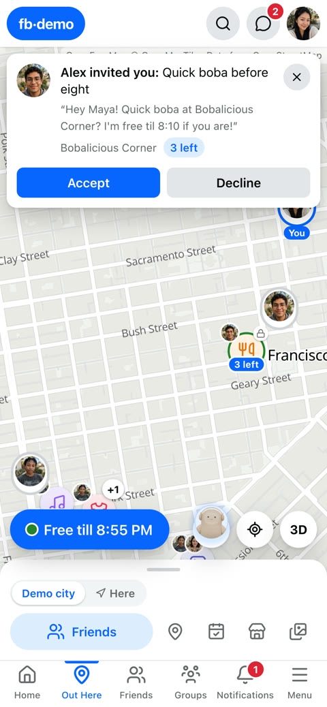<br><sub>The invite arrives</sub></td>
    <td align="center" width="20%">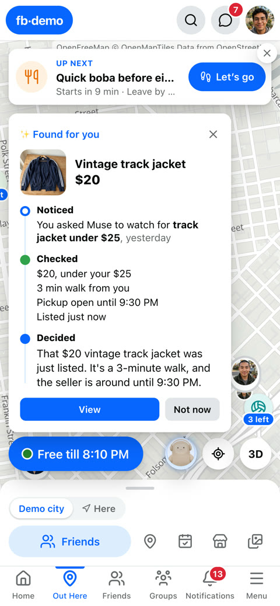<br><sub>A Muse find, with reasons</sub></td>
  </tr>
  <tr>
    <td align="center">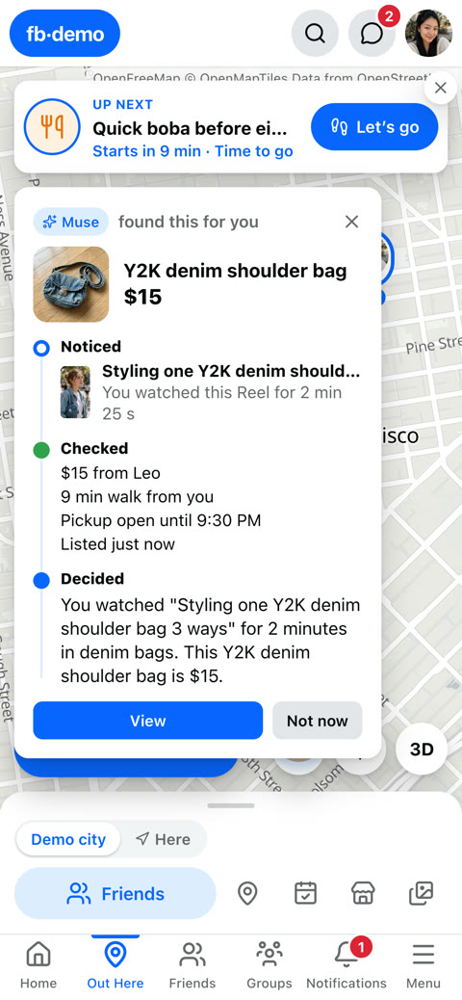<br><sub>Same sale, Maya's reason</sub></td>
    <td align="center">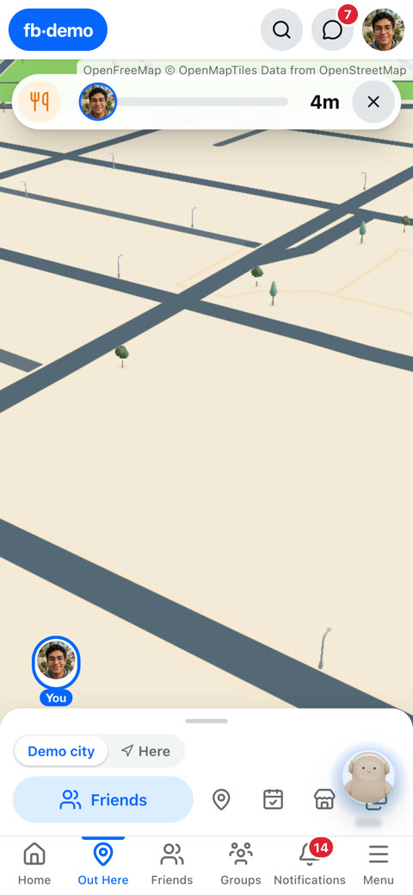<br><sub>Walking there in 3D</sub></td>
    <td align="center">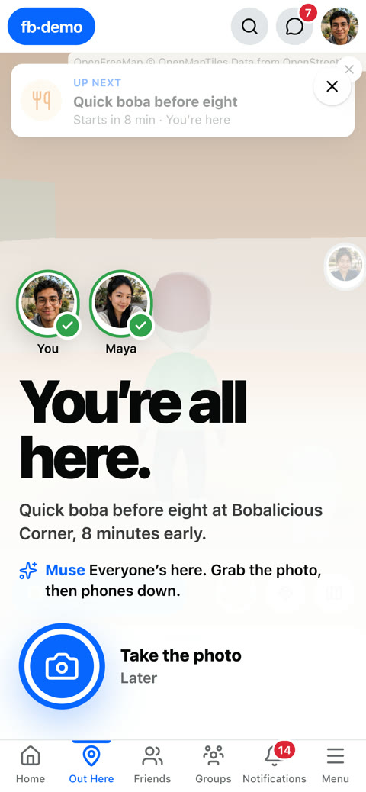<br><sub>Everyone arrived</sub></td>
    <td align="center">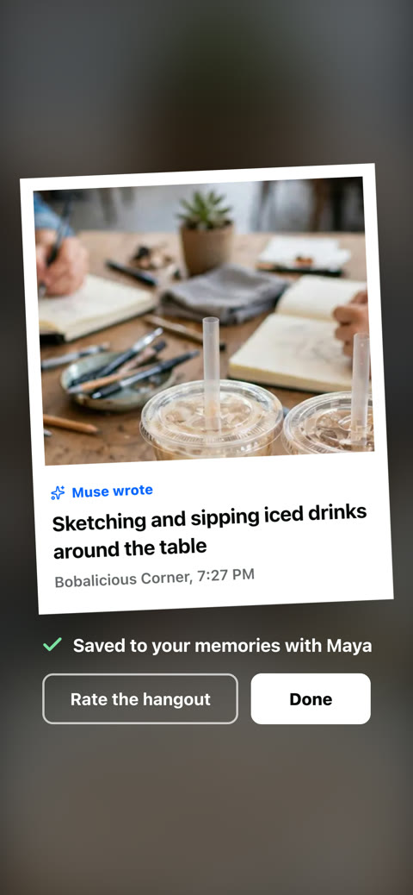<br><sub>Muse writes the caption</sub></td>
    <td align="center">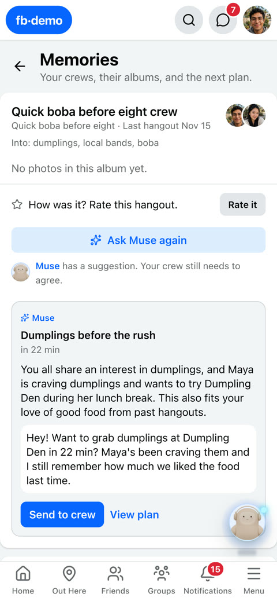<br><sub>The next plan</sub></td>
  </tr>
</table>

## How we use Muse

Muse makes the decisions that need judgment. Code handles every fact. Each Muse answer follows the same three steps, and the app shows all three on the card:

1. **Noticed:** real data from the app, such as a friend's status, a watch you set, a Reel you watched, or a place you rated.
2. **Checked:** code, not the model, works out the walking time, opening hours, price, open seats and whether it fits your window.
3. **Decided:** Muse picks from what code handed it and explains the choice in one sentence.

| Where | What Muse does |
|---|---|
| I'm free | Turns free text into a structured intent (activities, budget, time window, walking limit), ranks the real candidates, and explains the top picks |
| Draft a plan | When nothing posted fits, picks a real open place near both friends and writes the invite |
| Marketplace finds | Matches new listings to each person's watches and the Reels they watched, and explains the match |
| For you | Orders the activity chips from your past ratings and watch history |
| Photo caption | Looks at the photo and writes the caption for the shared album |
| Get together again | Proposes the next plan from the crew's shared interests, status bubbles and free time |
| Seed content | Muse Image generated every portrait and photo; Muse wrote the fictional people's bios and posts |

**Keeping it grounded.**
- Muse only chooses from ids that code hands it.
- Code then recomputes walking times, prices and seats, and drops anything that doesn't fit.
- If an answer names a place, price or person that isn't in the data, it's thrown out and a plain fallback is shown instead.
- Every call is logged with its model, latency, tokens and output, so we can show why Muse suggested anything.

**Why Ember.** We use `muse-ember-1.0` for the live paths. In our measurements it ranked plans in 2.5 to 3.3 s with the same top pick that `muse-spark-1.3` took 5.7 to 7.0 s to reach, and Spark timed out at 12 s on 30 Marketplace listings. When someone says "I'm free", speed matters more than size. See [`docs/DECISIONS.md`](docs/DECISIONS.md).

**Offline mode.** Without a Muse key, a deterministic mock stands in for each step, so the app and its tests run offline.

More detail: [`docs/muse-api.md`](docs/muse-api.md), [`docs/MUSE_INTEGRATION.md`](docs/MUSE_INTEGRATION.md).

## Privacy and safety

- Availability is visible to friends only, and only after you tap "I'm free".
- Location sharing uses the same audience settings as posts: friends, Close friends, a custom list, or nobody. It can be exact or approximate, can be paused, and expires on its own.
- A plan's exact spot stays fuzzed by about 200 m until you join. Plans are only at public places.
- Joining with a friend is the default. Plans with strangers need at least 3 people, and every plan has report and block.
- Muse only uses interests people chose to share, and never reveals private connections.

## Tech stack

- **[Next.js 15](https://nextjs.org)** (App Router, TypeScript, Tailwind CSS)
- **[Supabase](https://supabase.com):** Postgres, Storage and Realtime Broadcast.
  - The browser never queries tables. Route handlers apply the visibility rules.
  - Row-level security is on, with no anonymous policies.
  - Joining a plan is one atomic Postgres function, so the last seat can't be double-booked.
- **[MapLibre GL JS](https://maplibre.org)** with **[OpenFreeMap](https://openfreemap.org)** tiles for the map
- **[three.js](https://threejs.org)** for the 3D city, built with [Kenney](https://kenney.nl) assets
- **Muse:** Ember, Spark and Muse Image, through the `openai` SDK pointed at the Muse API
- **Vitest** and **Playwright** for tests; deployed on **Vercel**

## Run it locally

You need Node 20 or newer.

```bash
npm install
npm run dev
```

With no keys set, the app runs on seeded in-memory data and the offline Muse mock. Open two tabs as two different people:

- http://localhost:3000/out-here?as=alex
- http://localhost:3000/out-here?as=maya

Other personas: `jordan`, `priya`, `sam`, `leo`, `nina`, `kai`. To see a seller's pop-up, open `/out-here?as=leo&sell=popup`.

**With real Muse and Supabase:**

1. Copy `.env.example` to `.env.local`, then fill in the Muse key and your Supabase project.
2. Set up the database and the seed data:
   ```bash
   npm run db:migrate:dev
   npm run seed
   ```
3. Start the app with `npm run dev`.

**Checks:**

```bash
npm run typecheck && npm run lint && npm test
npm run test:e2e
```

## Project structure

```
src/
  app/              routes and API handlers (Next.js App Router)
  features/
    map/            the Out Here map, I'm free, plans, Marketplace pop-ups
    muse/           Muse client, prompts, candidates, validation, mock mode
    world/          the 3D city, characters and the Muse companion
    memories/       arrival photo, crew albums, "get this group together again"
    fb/             the Facebook-style app around it
    data/           data store (Supabase or in-memory), realtime hooks
  shared/           shared types, API contracts, seed story
supabase/           migrations and seed content
scripts/            seeding, migrations, image generation, Muse evals
tests/e2e/          Playwright flows
```

## Team

[@AndrewYin04](https://github.com/AndrewYin04) · [@alnnguyen](https://github.com/alnnguyen) · [@alwxngn](https://github.com/alwxngn) · [@allyytc](https://github.com/allyytc) · [@Rishab-Mal](https://github.com/Rishab-Mal)

## Credits

Out Here is a hackathon prototype and is not affiliated with Meta. It uses a neutral wordmark instead of Facebook's logo.

All people are fictional, and their photos were generated with Meta Muse Image. Maps are © OpenStreetMap contributors via OpenFreeMap and OpenMapTiles. The 3D assets are from Kenney (CC0). Full list: [`CREDITS.md`](CREDITS.md).
