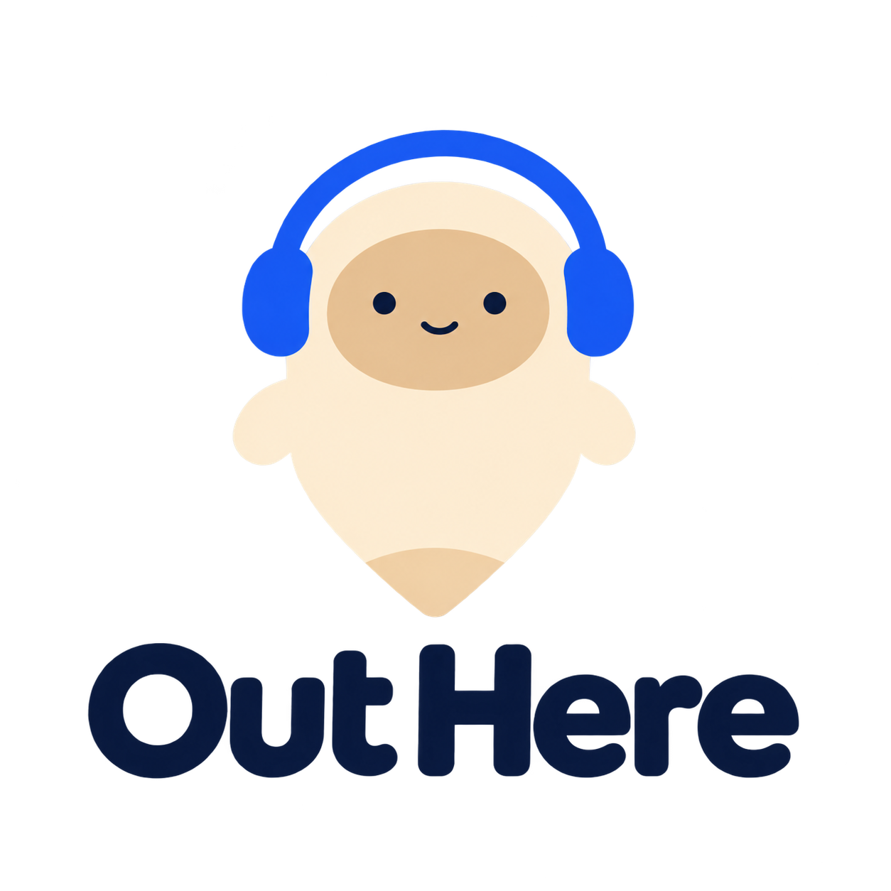
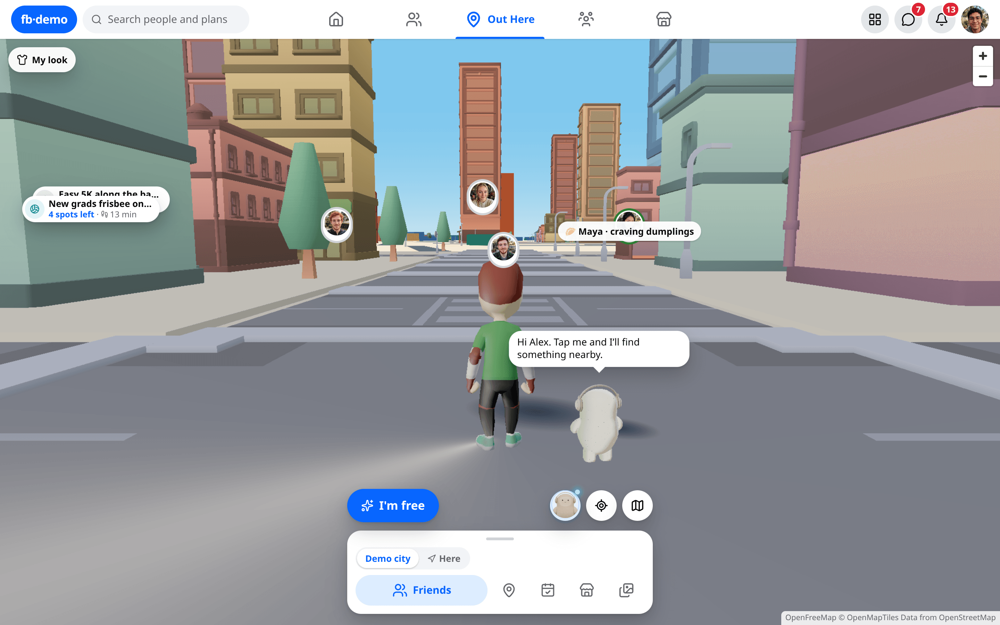
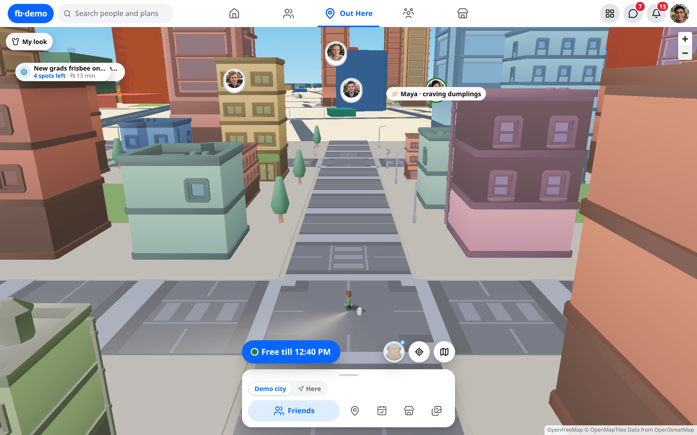
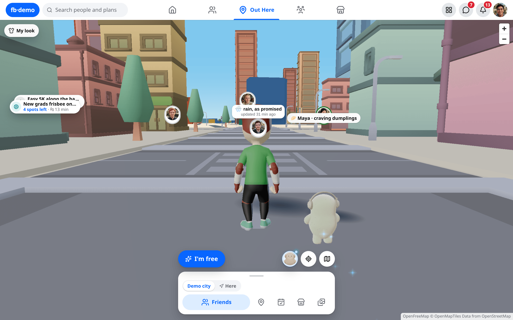
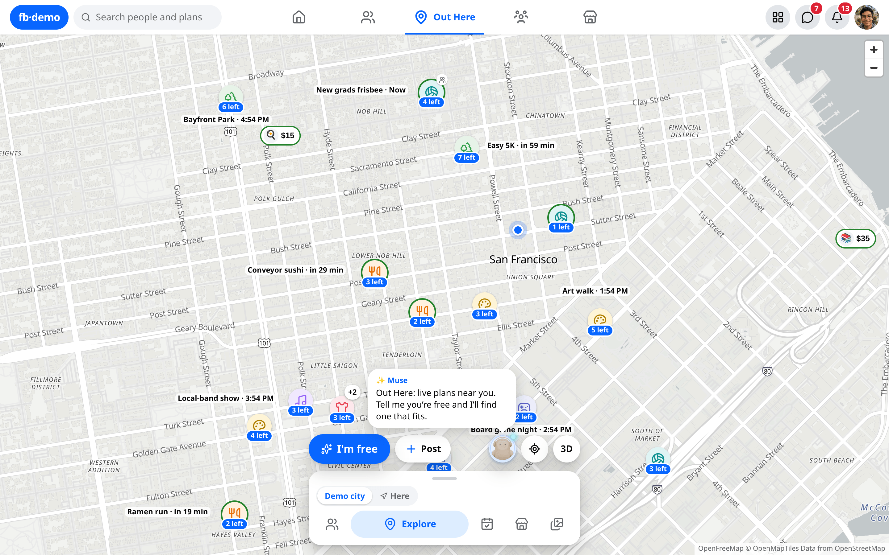
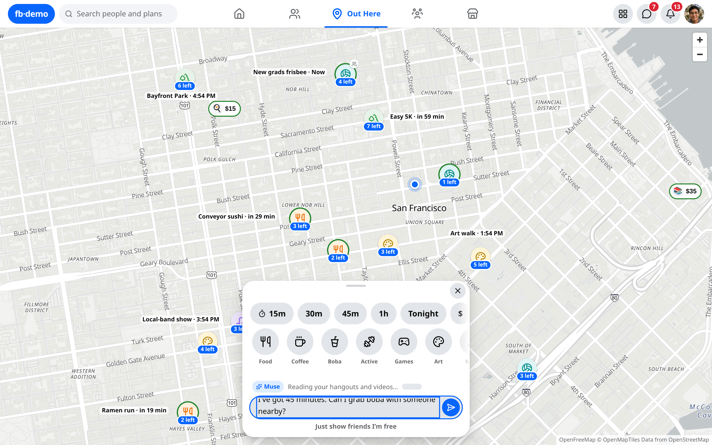
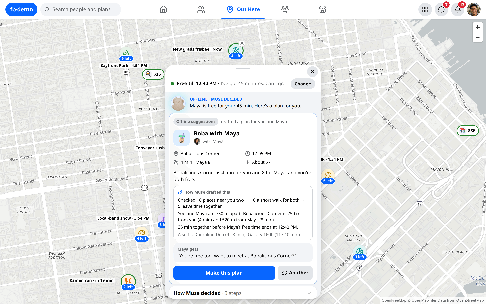
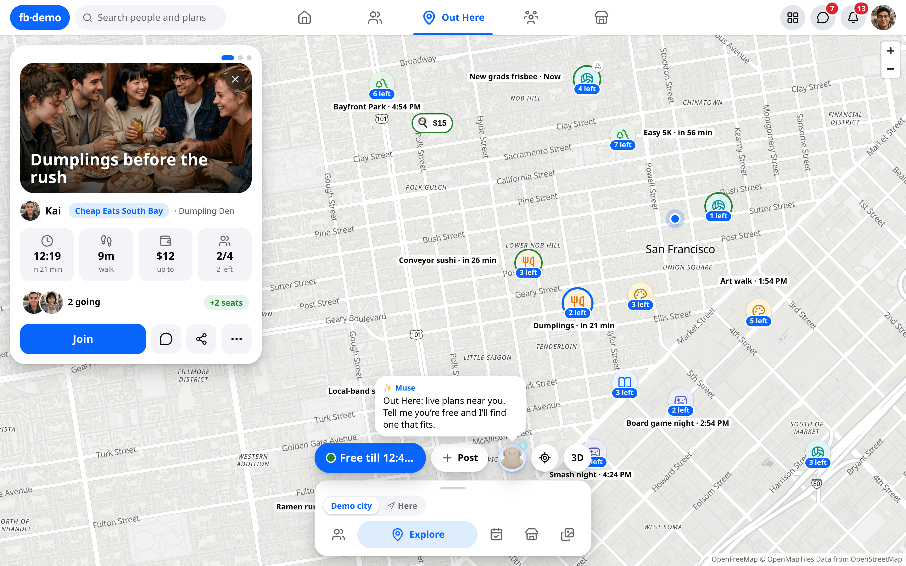
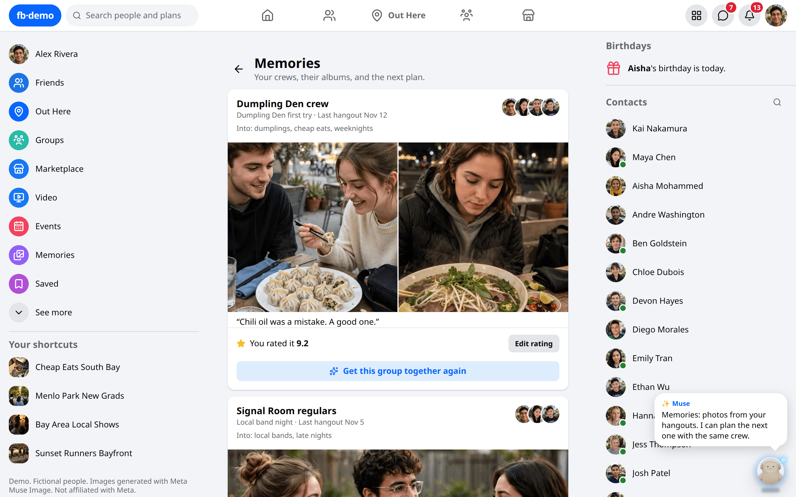

# Out Here



**Say you're free. Muse turns it into a real plan with a friend, and a map of people you can join right now.**

Built for Meta's Closer Together AI Hackathon in November 2026. It was invite-only, with 75 people admitted, and Meta funded travel and stay. No award or placement is claimed here.

**Demo (3 minutes):** [out here (Meta AI Hackathon 2026)](https://youtu.be/5RyUiRBquXs)

The hackathon deploy is [out-here-three.vercel.app](https://out-here-three.vercel.app). The screenshots below are from a local run of this repo.



## The problem

You have 40 minutes, you'd like to spend them with someone, and the group chat will not answer in time. Event apps list what was scheduled last week. They don't know that Maya is free after class, that you both want boba, and that a place you can walk to still has room.

Out Here is for that window. It is a Facebook-style app about fictional people in San Francisco. Out Here is one tab in it: a live map of small, joinable plans, with Muse in the middle of the loop.

## What it does

**I'm free → Muse finds a plan that fits → you join, and the seat count updates → you take a photo together → Muse can get that group together again.**

1. **You're on a map of plans happening soon.** Explore shows public plans with open seats (a dumpling counter, a 5K, a thrift walk). Friends shows people who chose to share where they are, with a short status ("craving dumplings"). Both views are the same data.
2. **You can walk it in 3D.** A third-person camera follows your character through a stylized downtown. Jolly, the Muse companion, walks with you. Friends nearby show up as people on the street. If you walk to a plan with someone else, their steps come back, so you see their character moving too. Zooming out returns to the flat map. Arrow keys, WASD, or the on-screen joystick move you. The default is the demo city, not your GPS.
3. **You tell Muse you're free, in your own words.** "I've got 45 minutes. Can I grab boba with someone nearby?" Muse reads the time, the budget, and what you're in the mood for. Code then keeps only plans you can actually reach, afford, and still get a seat at, including the walk. Muse ranks those and explains the pick. If nothing posted fits, it can draft a new plan with a friend who is free.
4. **You join, and the seat is real.** Joining is one write. A full plan stays full. A friend can be invited; the invite shows up for that persona. The exact meeting spot is hidden until you join. The public pin is offset by roughly 120–200 meters.
5. **Afterwards it remembers the group.** People who went are a crew. Photos go in a shared album, you can rate the hangout in private, and "Get this group together again" asks Muse for a next plan that still fits the crew.

Around that loop, the shell has a Home feed, profiles, friends, groups, notifications, Marketplace, and a Video page. Marketplace can rank listings from what that persona watched. A seller can also open a pop-up on the map. Muse can match a new listing to a watch you set or a Reel you watched, and the card shows what it noticed, what code checked, and what it decided. Search, the Events discover grid, and the Messenger inbox are still loading layouts. Your own plans are under Events → Going.

A daily prompt and a weekly hangout streak exist as seed data and API routes. They do not have their own screens. A monthly "Wrapped" recap is named in the API types only.

## Screens

The 3D street, pulled back. Plans and friends stay on the same block as your character.



A friend who shared their status, standing on the same street.



Explore: public plans on the San Francisco map, with seats left and when they start.



"I'm free," with a time and what you're up for, before Muse answers.



The plan Muse (or, without an API key, the offline stand-in) comes back with. This shot is the offline stand-in: same sheet, and the label says so. Walking time, price, and who is free are computed in code either way.



Open a plan to see who is going, what it costs, and how many seats are left. Join takes one.



The crew album after a hangout, with a private rating and a way to plan the next one.



## How Muse does the work

Muse is a model API (Ember and Spark, through one server-side adapter). The product is the split: the model writes language, and code keeps the facts.

| Step | What Muse does | What code guarantees |
|---|---|---|
| Understand | Turns a messy sentence into an intent: activity, budget, time window, how far you'll walk | The intent has to match a schema. If it doesn't, the plan stops |
| Fit | | Only real plans and friends that fit the window, including walking time, budget, and open seats, become candidates. A plan Muse drafts has to be a real place that is open for that window |
| Match and explain | Ranks those candidates and says why in plain language, including a friend when one is actually free | Muse can only choose from those candidates. It cannot invent a person, place, price, or time |
| Coordinate | Drafts the invite. If nothing posted fits, drafts a new plan | Joining takes a seat in one step. The last seat cannot be taken twice |
| Continue | Suggests a next plan for a crew, and can caption a photo you saved | The suggestion has to name a real plan the crew can still fit into. A caption you didn't accept is not saved |
| Create | Turns a short idea ("boba after class at 4") into a plan draft | The place and the numbers are checked before the plan exists |

Finds and the "for you" chips use the same split on the card: **Noticed** (a status, a watch, a Reel, a rating), **Checked** (code: walk, price, seats, open hours, whether a nearby plan backs the chip), and **Decided** (one sentence from Muse). Each call is logged with its model, latency, tokens, and output.

Without `MUSE_API_KEY`, or with `MUSE_MOCK=1`, the same screens run on a deterministic stand-in. Those answers are labeled offline. Photo understanding does not invent a description in that mode.

Ranking uses Ember (`muse-ember-1.0`) unless `MUSE_RANK_ROLE=smart`. The switch is recorded in [docs/DECISIONS.md](docs/DECISIONS.md): Spark at minimal effort took 5.7–7.0 s for the same top pick Ember reached in 2.5–3.3 s, and Spark timed out at 12 s on 30 Marketplace listings. Model ids and request shape are in [docs/muse-api.md](docs/muse-api.md).

## Safety and privacy

The people, posts, and venues are fictional. There is no real account system: each tab picks a persona (`?as=alex`, or the account menu).

- Location sharing is a choice: who can see you, exact or approximate, and pause. Approximate is the center of an ~800 m cell, not your point. A share expires after 4 hours unless it is refreshed.
- Someone who is not on the plan sees the fuzzed pin (about 120–200 m off). The sheet tells you the exact spot is shared after you join. If none of your friends are already in a plan, Muse drops it unless the plan's size is at least 3.
- A plan can be reported from its sheet.
- The browser never holds the database service key or the Muse key. Clients hear that something changed, then refetch. A location update does not include where the person is.
- GPS is off until you switch to Here or Live GPS. The demo walk does not read your location.
- The app does not read a calendar.

## Tech stack

From `package.json` and the code, not a wishlist:

- **Next.js 15** (App Router) and **React 19**, TypeScript, Tailwind CSS 4
- **Supabase** (Postgres, realtime, storage) when it is configured. Row-level security is on, and there are no anonymous table policies: the browser does not query tables. With no Supabase env, the same store runs in memory from the committed seed
- **MapLibre GL** and [OpenFreeMap](https://openfreemap.org) tiles. No map API key
- **three.js** for the characters, Jolly, and the street scenery, drawn in the map's WebGL context
- **Muse** through the `openai` package pointed at Meta's API. **Zod** checks model output
- Vitest and Playwright. Deployed on Vercel for the hackathon

Node 22 or newer.

## Architecture

`src/features/` is split by area: `map`, `world` (3D), `outhere` (the "I'm free" sheet), `muse`, `muse-companion`, `memories`, `fb`, and `data`. Screens live in `src/app/`. Shared types and the demo clock live in `src/shared/`.

One `DataStore` serves every page. `getStore()` uses Supabase when the URL and service key for `DATA_TARGET` are set, and the in-memory seed otherwise. Both go through the same rules for who can see a row.

The flat map and the 3D view read the same quests and friend pins. 3D changes the camera and draws characters on top. It is not a second database.

Muse never runs in the browser. `src/features/muse/client.ts` is the only caller. Each step returns structured JSON, and the route rejects output that names something the code did not already allow.

## Run locally

No keys required. You get the fictional city, the 3D view, and labeled offline Muse answers.

```bash
npm install
npm run dev
```

Open [http://localhost:3000/out-here?as=alex&view=3d](http://localhost:3000/out-here?as=alex&view=3d).

`?as=` picks a persona for that tab (`alex`, `maya`, `jordan`, `priya`, `sam`, `leo`, `nina`, `kai`). `?view=map` is the flat map. `?mode=explore` lists every public plan. Use two tabs with two personas to invite and join. `/out-here?as=leo&sell=popup` opens Leo's seller pop-up with the items filled in.

To point the app at Supabase and live Muse, copy `.env.example` to `.env.local`, fill it in, then `npm run db:migrate:dev` and `npm run seed`. `npm run seed:demo` writes the demo project. Never commit `.env.local`. The key names and model ids are in [docs/muse-api.md](docs/muse-api.md).

```bash
npm run typecheck
npm run lint
npm test
npm run test:e2e
npm run build
```

## Team

Roles are a short read of the commit history and `docs/TEAM.md`. They are a draft, not job titles.

| Name | GitHub | Role (draft) |
|---|---|---|
| Andrew Yin | [AndrewYin04](https://github.com/AndrewYin04) | Facebook shell, data, seed |
| Alan Nguyen | [alnnguyen](https://github.com/alnnguyen) | 3D street, map |
| Alex Nguyen | [alwxngn](https://github.com/alwxngn) | Muse plans, invites |
| Ally Chen | [allyytc](https://github.com/allyytc) | UI design, 3D world, Muse companion |
| Rishab-Mal | [Rishab-Mal](https://github.com/Rishab-Mal) | Marketplace, plans, Video |

Rishab-Mal's GitHub profile has no display name, and the repo doesn't give one, so the table uses the handle.

How we built it: the team coordinated an AI coding agent overnight. The run book, board protocol, and demo script are in [docs/BUILD_PROCESS.md](docs/BUILD_PROCESS.md). The rest of the docs are indexed in [docs/README.md](docs/README.md).

## Credits

Out Here was built at Meta's Closer Together AI Hackathon, an invite-only event hosted by Meta (75 participants admitted). It uses a neutral wordmark instead of Facebook's logo.

The people, posts, and venues are fictional. Portraits and other seed images were generated with Meta Muse Image. Map tiles are [OpenFreeMap](https://openfreemap.org), © OpenMapTiles, data from OpenStreetMap. The person model and street kits are from Kenney under CC0. Details are in [CREDITS.md](CREDITS.md).
